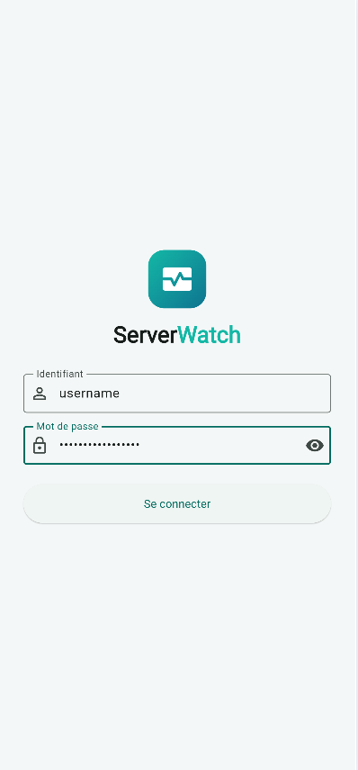
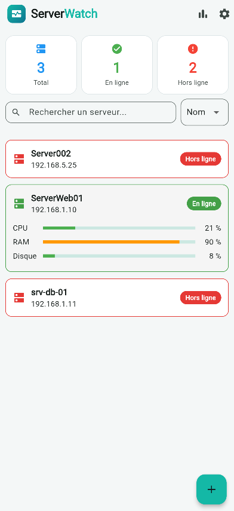
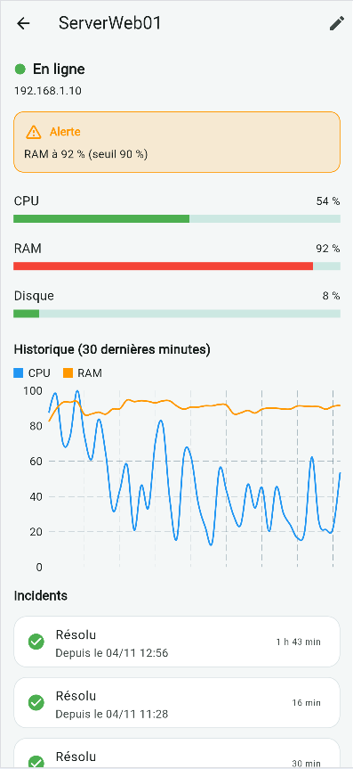
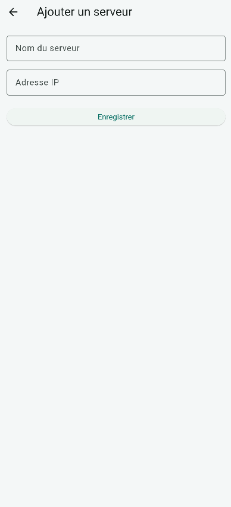
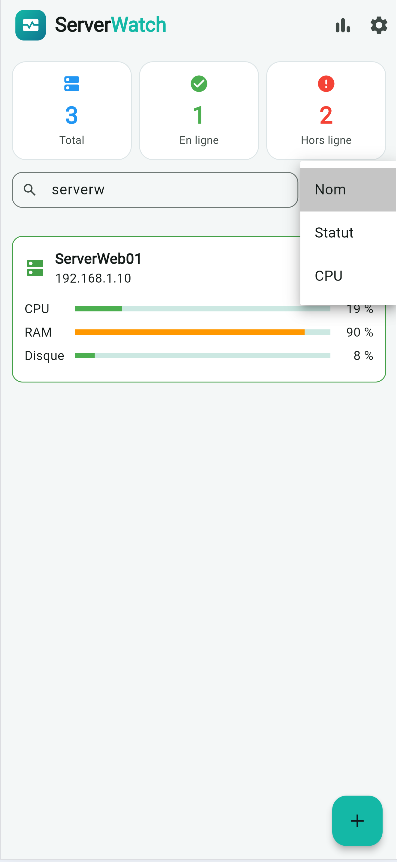
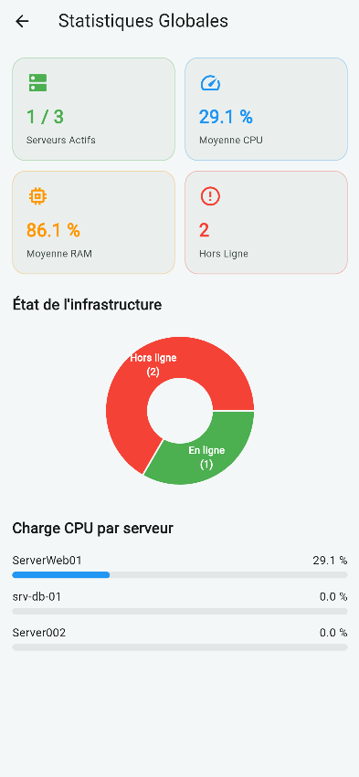
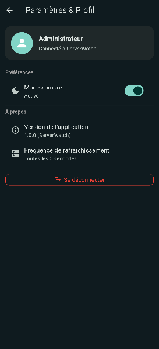
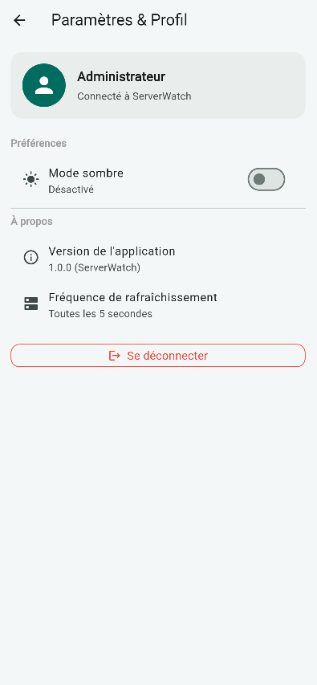

# ServerWatch

Application mobile de supervision de serveurs. Elle affiche l'état de plusieurs machines (en ligne ou hors ligne, CPU, RAM, disque) et détecte automatiquement quand un serveur cesse d'envoyer des mesures.

Projet personnel réalisé en autonomie dans le cadre de ma formation (L2 Informatique, Administration Système et Réseau).

## Captures d'écran

| Liste des serveurs | Détail d'un serveur | Ajout d'un serveur |
|---|---|---|
|  |  |  |

## Fonctionnement

```
Agent Python  →  API FastAPI  →  PostgreSQL  ←  Appli Flutter
(mesures)        (REST, JSON)     (données)      (affichage)
```

1. L'**agent** (`agent/`) mesure le CPU, la RAM et le disque de la machine toutes les 10 secondes et les envoie à l'API.
2. L'**API** (`api/`) enregistre les mesures dans PostgreSQL.
3. Un serveur est considéré **en ligne** s'il a envoyé une mesure dans les 90 dernières secondes, sinon **hors ligne**.
4. L'**appli mobile** (`lib/`) interroge l'API toutes les 5 secondes et met l'affichage à jour.

## Fonctionnalités

- Tableau de bord avec le nombre de serveurs en ligne et hors ligne
- Détail d'un serveur avec barres CPU, RAM et disque (vert, orange ou rouge selon la charge)
- Ajout et suppression de serveurs, enregistrés en base de données
- Actualisation automatique et gestion des erreurs réseau

## Technologies

- **Appli** : Flutter (Dart)
- **API** : Python, FastAPI, psycopg
- **Base de données** : PostgreSQL
- **Agent** : Python, psutil

## Lancer le projet

### 1. Base de données

Créer une base `server_watch` dans PostgreSQL, puis exécuter `database/schema.sql`.

### 2. API

```
cd api
python -m venv .venv
.\.venv\Scripts\python.exe -m pip install fastapi uvicorn "psycopg[binary]" python-dotenv
```

Créer un fichier `api/.env` (non versionné) :

```
DB_HOST=localhost
DB_PORT=5432
DB_NAME=server_watch
DB_USER=postgres
DB_PASSWORD=votre_mot_de_passe
```

Lancer l'API :

```
.\.venv\Scripts\python.exe -m uvicorn main:app --reload
```

La documentation interactive est disponible sur `http://127.0.0.1:8000/docs`.

### 3. Agent de mesure

```
.\api\.venv\Scripts\python.exe -m pip install psutil requests
.\api\.venv\Scripts\python.exe agent\agent.py
```

### 4. Application

```
flutter pub get
flutter run -d chrome
```

## Prochaines étapes

- Graphique d'historique des mesures
- Notifications push quand un serveur tombe
- Authentification de l'API

# ServerWatch 🖥️📱

**ServerWatch** est une application mobile de supervision de serveurs développée en **Flutter** (frontend) connectée à une API **FastAPI / Python** (backend) sécurisée par une base de données **PostgreSQL**.

## Fonctionnalités principales
- 🔐 **Authentification sécurisée** (Connexion par identifiant et mot de passe haché).
- 📊 **Tableau de bord en temps réel** (Suivi du CPU, de la RAM et du statut en ligne/hors ligne rafraîchi automatiquement).
- 🔍 **Recherche et Tri instantanés** (Filtrage par nom et tri par nom, statut ou charge CPU).
- 🌙 **Mode sombre / Mode clair** (Basculement dynamique des thèmes).
- ➕ **Gestion des serveurs** (Ajout de nouveaux serveurs et suppression par geste *Swipe*).

---

## Captures d'écran

## Captures d'écran

<table>
  <tr>
    <td align="center"><br>Connexion</td>
    <td align="center"><br>Liste des serveurs</td>
    <td align="center"><br>Détail d'un serveur</td>
    <td align="center"><br>Ajout d'un serveur</td>
  </tr>
  <tr>
    <td align="center"><br>Tri et recherche</td>
    <td align="center"><br>Statistiques</td>
    <td align="center"><br>Mode sombre</td>
    <td align="center"><br>Mode clair</td>
  </tr>
</table>

## Installation & Lancement

### 1. Configuration de la Base de Données & API (Backend)
```bash
cd api
# Installer les dépendances Python
pip install -r requirements.txt

# Créer un utilisateur administrateur
python create_user.py

# Lancer l'API avec Uvicorn
python -m uvicorn main:app --reload